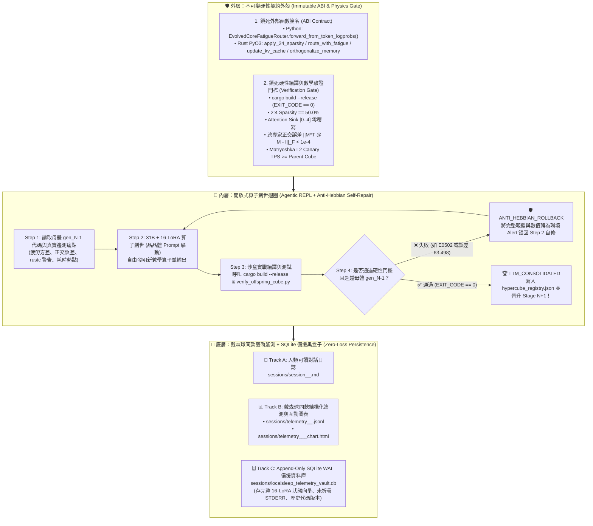

# 🧊 25 階超立方體開放式算子創世規格書 (Hypercube 25-Stage Open-Ended Operator Genesis Spec)

- **建立時間**：`2026-11-05 00:26 ~ 00:33 (GMT+8)`
- **專案路徑**：`/home/node/.openclaw/workspace/projects/rust_localsleep-moe`
- **架構師**：Leon (`闇鷲 / omegacd`) & Kuro (`小黑`)
- **當前狀態**：📝 **規格凍結待實作（明日睡醒開寫，今晚不動任何執行碼）**

---

## 一、核心設計哲學：從「戴森球 Stage 7➔25」到「超立方體 `gen_019➔gen_043`」的同構移植

本規格將 `rust_dysonsphere_sim` 在 Stage 7 之後驗證大獲成功的 **「硬契約外殼 + 開放式內部創世（Contract-Bounded Open-Ended Genesis）」** 框架，以及 **「雙軌資料遙測架構（Markdown + JSONL/Chart + SQLite 黑盒子）」**，完整移植至 `rust_localsleep-moe` 主視窗與 4D 超立方體無性生殖引擎（`hypercube_replicator.py` / `hypercube_headless_cli.py`）。



---

## 二、Prompt 語言工程規範：「70/30 工程師晶晶體」超頻配方 (Bilingual Negentropy Optimum)

根據 `2026-11-03 00:53` 與 `2026-11-05 00:11` 實機遙測證明，超立方體演化在呼叫 `Gemma-4-31B-IT-NVFP4 + 16-LoRA` 時，系統與階段 Prompt 必須採用 **「70% 繁體中文高密度拓撲描述 + 30% 英文原生 AST 符號錨點」**：

1. **70% 繁體中文負責「高維拓撲壓縮與多專家共振」**：
   - 使用高資訊密度中文詞彙（如「正交基底秩坍縮」、「零拷貝遮罩路由」、「環形緩衝區 Attention Sinks」、「反赫布回滾」），將初始 Token Prefill 的 Shannon 熵值推升至黃金區間 $H_0 \in [1.8, 2.2]$。
   - 高熵值將自動觸發路由器 `Auto Top-5` 擴展，同時喚醒 5 顆正交 LoRA 專家（如 `[E07, E00, E14, E08, E15]`）協同推理。
2. **30% 英文原生 Token 負責「零損耗 AST 座標定錨」**：
   - 所有 Rust Crate、Trait、方法名稱與數學範數一律直接嵌入英文原生 Token（如 `SmallVec<[(usize, f64); 4]>`, `chunks_exact_mut(4)`, `into_par_iter()`, `mapv_inplace`, `partial_cmp().unwrap_or(Ordering::Equal)`, `||M^T @ M - I||_F`）。
   - 直接命中模型預訓練權重中的 GitHub Rust 原始碼子空間，徹底消除自然語言轉譯造成的生命週期/借用檢查誤差。

---

## 三、明日手術清單 (Part 1)：改造 `hypercube_replicator.py` 邁向 25 階無限創世

### 1. 移除現有 Stage 3 的靜態字串模板（`hypercube_replicator.py` 第 481~610 行）
- **現況問題**：目前 `run_evolution_step_3_synthesize_offspring_code` 僅將預設 Python 字串寫入 `evolved_homeostasis.py`，不會讓 31B 自由修改 Rust 算子，也不會執行 `cargo build --release`。
- **明日改造**：將主視窗 `EmbodiedToolHarness` 的 **「`<file>` 寫檔 + `run_sandbox_shell` 執行編譯 + 失敗自動重修（最多 $K=4$ 輪）」** 植入超立方體的 `Stage 3 & Stage 4`。

### 2. 第一代起點（`gen_018 ➔ gen_019`）：植入沙盒已驗證的兩大神級算子
先將今晚在沙盒 `isolated_output/prj_20261104_235052_67bf865c/src/lib.rs` 實證通過（`0.000000` 誤差）的兩項突破作為 `gen_019` 的種子基因：
1. **零邊界檢查 2:4 結構化稀疏剪枝 (`src/downscaler.rs` / `src/lib.rs`)**：
   - 以 `row.as_slice_mut().unwrap().chunks_exact_mut(4)` 取代傳統索引迴圈，搭配 `SmallVec<[(usize, f64); 4]>` 堆疊排序與 `rayon::into_par_iter()` 多核並行。
2. **抗共線退化之 Modified Gram-Schmidt 正交化算子 (`orthogonalize_memory`)**：
   - 採用雙緩衝快照避免 Rust `E0502` 借用衝突；
   - 當向量範數 `norm <= 1e-9`（線性相關或全零退化）時，使用 64-bit Knuth LCG (`state = state.wrapping_mul(6364136223846793005).wrapping_add(1442695040888963407)`) 對整條隱藏維度注入隨機高斯近似方向並重跑 MGS 投影，確保 `||M^T @ M - I||_F < 1e-6`。

### 3. 開啟「25 階超立方體無限創世迴圈（Stage 1 ➔ Stage 25）」
仿照戴森球模擬器的 `stage_list.json` 機制，在超立方體引擎中建立 `hypercube_evolution_stages.json`：
- **Stage 1 ~ Stage 6（基礎算子收斂階）**：
  - 依序完成：① 2:4 零拷貝稀疏化 ➔ ② `mapv_inplace` 原地疲勞衰減路由 ➔ ③ 環形 KV-Cache Attention Sinks 保護 ➔ ④ LCG 抗退化 MGS 正交化 ➔ ⑤ Per-Token Logprobs 量子穿隧自適應 Top-K ➔ ⑥ 跨層級俄羅斯娃娃 L2 Canary 吞吐率基準線鎖定。
- **Stage 7 ~ Stage 25（開放式第一性原理算子創世階 `new_operator_genesis`）**：
  - 從第 7 階開始，每一階由 `31B + 16-LoRA` 根據上一階的實測瓶頸（如長序列熵漂移、特定專家群共振鎖死、Cache Line 偽共享等），自主提出新算子假說（例如 Chebyshev 譜濾波疲勞衰減、Householder 反射正交化、SIMD 向量化 Top-K 分揀等），並在子代目錄中完成 **「寫碼 ➔ `cargo build --release` ➔ 驗證通過 ➔ 晉升下一階母體」** 的全自主閉環！

---

## 四、明日手術清單 (Part 2)：沿用戴森球「雙軌資料架構」+ SQLite 備援黑盒子

為徹底解決單靠 `.md` 容易因手滑覆蓋或 UI 折疊而遺失細節的問題，明日同步將 **戴森球模擬器 (`rust_dysonsphere_sim`) 的雙資料流架構** 升級移植過來，並加上 **SQLite WAL 備援資料庫**：

### 1. 戴森球同款雙軌檔案輸出 (`sessions/`)
每次對話與超立方體演化，除了原本的 `session_<profile>_<ts>.md` 外，背景即時 Append 寫入：
1. **`sessions/telemetry_<profile>_<ts>.jsonl`（逐輪/逐階段結構化遙測串流）**：
   - 每一行 JSON 完整記錄：
     - `turn_idx`, `timestamp`, `profile_id`, `model_id`, `active_cube_id`, `sandbox_dir`
     - **完整 16-LoRA 狀態遙測**：
       - `selected_top_k`: 例 `[7, 0, 14, 8, 15]`
       - `shannon_entropy`: 例 `2.143`
       - `lora_weights_16`: 長度 16 的瞬時混合權重向量 `[w_0, w_1, ..., w_15]`
       - `lora_fatigue_16`: 長度 16 的瞬時疲勞度向量 `[f_0, f_1, ..., f_15]`
       - `nrem_sleeping_experts`: 當下疲勞度超過閾值進入睡眠遮罩的專家列表
       - `nrem_24_prune_count`: 該輪累積 NREM 2:4 剪枝次數（如 `1071`）
     - **推論與沙盒驗證指標**：
       - `tokens`, `tps`, `ttft_ms`, `elapsed_sec`
       - `sandbox_exit_code`, `hebbian_trace_state` (`LTM_CONSOLIDATED` / `ANTI_HEBBIAN_ROLLBACK`)
2. **`sessions/telemetry_<profile>_<ts>_chart.html`（一鍵互動式戰報圖表）**：
   - 跟戴森球模擬器一樣，自動生成單一自包含 HTML 戰報（內嵌 Chart.js，包含 **16-LoRA 疲勞度熱力軌跡圖、Shannon 熵 $H(p)$ 曲線、TPS 吞吐率曲線、反赫布回滾/固化事件標記點**）！

### 2. SQLite WAL 備援黑盒子資料庫 (`sessions/localsleep_telemetry_vault.db`)
所有寫入 `.md` 與 `.jsonl` 的資料，同時以 **Append-Only（只增不刪、永不覆寫）** 寫入 `localsleep_telemetry_vault.db`：

```sql
PRAGMA journal_mode = WAL;
PRAGMA synchronous = NORMAL;

-- (1) Session 主表
CREATE TABLE IF NOT EXISTS sessions (
    session_id TEXT PRIMARY KEY,
    profile_id TEXT NOT NULL,
    model_id TEXT NOT NULL,
    server_url TEXT,
    active_cube_id TEXT,
    sandbox_dir TEXT,
    md_path TEXT,
    jsonl_path TEXT,
    started_at TEXT NOT NULL
);

-- (2) Turn 對話與 16-LoRA 狀態遙測總表 (連完整 Prompt、Raw 輸出與 16-LoRA 狀態一併鎖入 DB)
CREATE TABLE IF NOT EXISTS session_turns (
    turn_id INTEGER PRIMARY KEY AUTOINCREMENT,
    session_id TEXT NOT NULL,
    turn_index INTEGER NOT NULL,
    timestamp TEXT NOT NULL,
    user_prompt TEXT NOT NULL,
    assistant_raw_text TEXT NOT NULL,
    tokens_generated INTEGER,
    elapsed_sec REAL,
    tps REAL,
    ttft_ms REAL,
    shannon_entropy REAL,
    selected_top_k_json TEXT,         -- 例: "[7, 0, 14, 8, 15]"
    lora_weights_16_json TEXT,        -- 16 顆 LoRA 專家權重分佈 [w_0 .. w_15]
    lora_fatigue_16_json TEXT,        -- 16 顆 LoRA 專家疲勞度向量 [f_0 .. f_15]
    nrem_masked_experts_json TEXT,    -- 被施加 NREM 遮罩的專家列表
    nrem_24_prune_count INTEGER,
    hebbian_trace_state TEXT          -- "LTM_CONSOLIDATED" / "ANTI_HEBBIAN_ROLLBACK"
);

-- (3) 16-LoRA 逐抽樣步微觀軌跡表 (Intra-Turn LoRA Phase-Space Trajectory)
CREATE TABLE IF NOT EXISTS lora_step_traces (
    trace_id INTEGER PRIMARY KEY AUTOINCREMENT,
    turn_id INTEGER NOT NULL,
    token_step INTEGER NOT NULL,
    token_id INTEGER,
    shannon_entropy REAL,
    selected_top_k_json TEXT,
    lora_weights_16_json TEXT,
    lora_fatigue_16_json TEXT
);

-- (4) 沙盒代碼版本歷史庫 (Immutable Code Artifact Vault)
-- 每次模型輸出 <file path="...">，不論同名與否一律新增一筆，永遠不怕舊檔被蓋掉！
CREATE TABLE IF NOT EXISTS artifact_versions (
    artifact_id INTEGER PRIMARY KEY AUTOINCREMENT,
    session_id TEXT NOT NULL,
    turn_id INTEGER NOT NULL,
    sandbox_rel_path TEXT NOT NULL,   -- 例: "src/lib.rs"
    sha256_hash TEXT NOT NULL,
    byte_size INTEGER NOT NULL,
    content_text TEXT NOT NULL,       -- 完整原始碼本體直接進 DB！
    created_at TEXT NOT NULL
);

-- (5) 沙盒 Shell 編譯與測試 100% 未折疊原始 Log 表
CREATE TABLE IF NOT EXISTS sandbox_exec_logs (
    exec_id INTEGER PRIMARY KEY AUTOINCREMENT,
    session_id TEXT NOT NULL,
    turn_id INTEGER NOT NULL,
    sub_turn_idx INTEGER NOT NULL,
    command TEXT NOT NULL,
    cwd TEXT NOT NULL,
    exit_code INTEGER NOT NULL,
    stdout_full TEXT,                 -- 100% 未折疊完整 STDOUT
    stderr_full TEXT,                 -- 100% 未折疊完整 STDERR (含完整 rustc 報錯)
    hebbian_trace_state TEXT,
    executed_at TEXT NOT NULL
);
```
